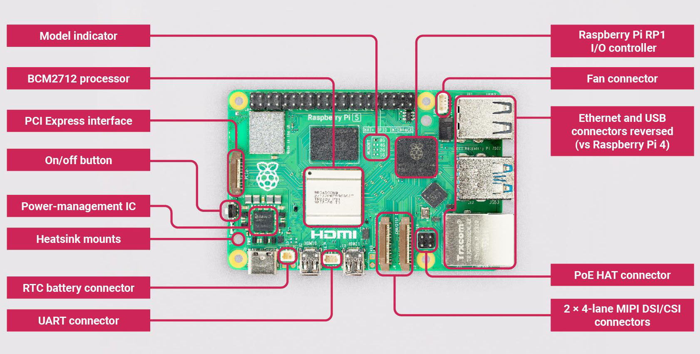

# 기초 개념 (basics)

라즈베리 파이를 쓰기 전에 알아 두면 좋은 간단한 개념 정리.

## 목차
- [라즈베리 파이란?](#라즈베리-파이raspberry-pi란)
- [아두이노와 비교](#아두이노arduino와-비교)
- [왜 라즈베리 파이를 마이크로 컨트롤러라고 부르면 안될까?](#왜-라즈베리-파이를-마이크로-컨트롤러라고-부르면-안될까)
- [컴퓨터의 필수 구성요소](#컴퓨터의-필수-구성요소)
- [마이크로컨트롤러의 필수 구성요소](#마이크로컨트롤러의-필수-구성요소)
- [라즈베리 파이 5 구조](#라즈베리-파이-5-구조)
- [라즈베리파이 이미저](#라즈베리파이-이미저raspberry-pi-imager)
- [라즈베리파이 기본 설정](#라즈베리파이-기본-설정raspberry-pi-configuration)
- [앞으로 정리할 내용](#앞으로-정리할-내용)

   

## 라즈베리 파이(Raspberry Pi)란?
라즈베리 파이(Raspberry Pi)는 손바닥만 한 크기의 저가형 소형 컴퓨터로, 주로 코딩 학습과 다양한 전자 프로젝트에 활용. 리눅스 기반 운영체제를 사용하며, HDMI, USB, Wi-Fi, GPIO(입출력 핀) 등 다양한 연결 기능을 갖추고 있어 키보드, 모니터를 연결하면 일반 컴퓨터처럼 사용 가능. Python 또는 C 언어 등으로 프로그래밍 할 수 있으며, 센서나 모터를 연결해 사물인터넷(Internet of Things, IoT), 로봇 제어, 얼굴 인식 같은 프로젝트도 가능. 성능은 스마트폰보다 낮지만, 교육용이나 창의적인 메이커 활동에 매우 적합.

   

## 아두이노(Arduino)와 비교
| 항목 | 라즈베리 파이 | 아두이노 |
|-----|-----|-----|
| 종류            | 소형 컴퓨터           | 마이크로 컨트롤러 |
| 운영체제        | Linux 기반 OS         | 없음              |
| 프로그래밍 언어 | Python, C/C++ 등      | C/C++             |
| 멀티태스킹      | 가능                  | 불가능(단일 루프) |
| 구성요소        | CPU, RAM(큼), 저장장치(SD 등), I/O | CPU, RAM(작음), Flash 메모리, I/O |
| 메모리(RAM)     | GB 단위 (파이 5: 2·4·8·16GB) | KB 단위 (아두이노 우노: 2KB) |
| 주목적          | 범용 컴퓨팅, 영상 출력, 인터넷 연결, 데이터 처리  |  센서/모터 제어, 단순 반복 제어 | 
| 사용 예시        | 미디어 재생, 웹서버, 얼굴 인식 처리 | 전등 자동 제어, 온도 감지 후 팬 켜기 |
| 전원 ON 시 동작 | OS 부팅 -> 로그인 -> 프로그램 실행 | 프로그램 실행 |

   

## 왜 라즈베리 파이를 마이크로 컨트롤러라고 부르면 안될까?
마이크로 컨트롤러는 단순 제어에 특화된 "제어 전용칩" 인 반면에 라즈베리 파이는 CPU, RAM, 저장 장치등 여러 부품이 결합된 소형 컴퓨터.

   

## 컴퓨터의 필수 구성요소
| 구성요소 | 설명 |
|-----|-----|
| CPU | 명령을 처리하고 연산 수행(중앙처리장치) |
| RAM | 프로그램 실행 중 데이터를 저장하고 읽어오는 임시 기억 장치 |
| 저장장치 | 운영체제 및 프로그램 저장 (비휘발성 = 전원이 꺼져도 유지) (예: SD카드, SSD, HDD 등) |
| 입출력 장치 | 사용자의 명령을 받고 결과를 출력하는 수단 (예: 키보드, 모니터 등) |
 - 운영체제(OS)는 소프트웨어지만, 현대 컴퓨터가 실용적으로 동작하려면 필수. 특수 목적의 경우 OS 없이 부트 가능(임베디드 부트로더)
 - 마더보드, 전원공급장치 등은 필수이나, 구현 방식 또는 하드웨어 인프라에 가깝기에 논외

   

## 마이크로컨트롤러의 필수 구성요소
 - '한 칩에서 컴퓨터처럼 동작하도록 만든 장치'이므로, 한 개의 칩에 다음 요소들이 반드시 포함되어야 함

| 구성요소 | 설명 |
|-----|-----|
| CPU | 연산 및 명령 실행|
| RAM | 실행 중인 작업에 필요한 임시 데이터 저장 |
| Flash ROM(또는 EEPROM) | 프로그램 코드 저장 (전원 꺼져도 유지) |
| I/O핀 | 외부 장치와 신호 주고 받음(디지털/아날로그 신호) |
 - 타이머, ADC, UART, SPI, I2C와 같은 요소는 필수 아님. 하지만 대부분 내장. 

   

## 라즈베리 파이 5 구조

출처: https://www.kiwi-electronics.com/en/raspberry-pi-5-16gb-20255

| 부품 | 내용 |
|-----|-----|
| CPU | Broadcom BCM2712, 4코어 Arm Cortex-A76, 2.4GHz |
| RAM | 2GB / 4GB / 8GB / 16GB 중 선택 |
| GPIO | 40핀 헤더 (3.3V 신호). 핀 배치는 [iphone-app GPIO 탭](../iphone-app/README.md#파트-2-gpio-탭-라즈베리-파이-5-핀아웃) 그림 참고 |
| USB | USB 3.0 포트 2개(파란색) + USB 2.0 포트 2개 |
| 화면 | micro HDMI 포트 2개 (4K 화면 2대까지) |
| 네트워크 | 기가비트 이더넷(랜선), Wi-Fi 5, 블루투스 5.0 |
| PCIe | PCIe 2.0 x1 커넥터. AI 가속기(Hailo)나 NVMe SSD를 연결하는 확장 보드(HAT+)용 |
| 전원 | USB-C, 5V 5A(27W) 전원 어댑터 권장 |
| 기타 | 전원 버튼, 실시간 시계(RTC, 배터리 단자 별도), 카메라·디스플레이 커넥터 2개 |

   

## 라즈베리파이 이미저(Raspberry Pi Imager) 
운영체제 이미지를 SD카드 또는 USB로 플래싱해주는 프로그램. 라즈베리파이는 운영체제로 '라즈베리파이 OS(Raspberry Pi OS)' 사용. 우분투(Ubuntu), 리트로파이(RetroPie) 등도 목적에 따라 사용

- '플래싱'이란, 운영체제 이미지 파일을 SD카드나 USB에 그냥 복사하는 게 아니라, 그 저장장치가 "운영체제 부팅이 가능한 상태"가 되도록 통째로 덮어써 주는 작업
- '이미지'란, 운영체제가 설치된 저장장치 전체를 복사한 파일(.img 확장자)
- 다운로드: [Raspberry Pi 공식 소프트웨어 페이지](https://www.raspberrypi.com/software/) (Windows·Mac·Ubuntu용, 항상 최신 버전)
- 설치할 때 설정(톱니바퀴) 화면에서 파이 이름(hostname), 사용자 이름·비밀번호, Wi-Fi, SSH를 미리 정할 수 있음. 여기서 정한 이름이 `이름.local` 주소가 됨 (이 파이는 `user-root` → `user-root.local`)

   

## 라즈베리파이 기본 설정(Raspberry Pi Configuration)
- System: To desktop(GUI), To CLI(Command Line Interface)
- Display: underscan(가장자리 여백처리), screen blanking(절전 모드)
- Interfaces: SSH(Secure Shell, 다른 컴퓨터에서 명령어로 접속), VNC(Virtual Network Computing, 다른 컴퓨터에서 화면 보며 접속), SPI·I2C·Serial(GPIO 핀을 그 기능으로 쓰기) 켜고 끄기
- Performance: GPU, Overlay File, Fan 설정 등
- Localisation: 국가 또는 글자, 시간 설정이 가능

   

## 앞으로 정리할 내용
1. 리눅스 명령어 (Linux commands)
2. GPIO 핀 배치 (GPIO layout)
3. 핀 번호 방식: BOARD(물리 핀 번호) vs BCM(GPIO 번호)
4. 파이썬 가상환경 (virtual environment)
5. 간단한 회로: 파이 3.3V → LED → 저항 → 파이 GND
6. GPIO 라이브러리 비교: RPi.GPIO vs gpiozero
7. 기타 라이브러리
8. 회로: 파이 GPIO → LED → 저항 → GND
9. 입력 모드 (input mode)
10. 플로팅 (floating, 입력 핀이 어디에도 연결 안 된 불안정한 상태)
11. 풀업 / 풀다운 (pull up / pull down)
12. 회로: 파이 GPIO → LED → 저항 → GND + 스위치
13. PWM (밝기·속도 조절용 신호)
14. 예제 + 회로: GPIO → LED A → 저항 + LED B (듀티 사이클 50%) → 저항 → GND
15. pigpio: 라즈베리 파이 5에서는 동작 안 함 (파이 4까지만 지원)
16. git으로 GitHub에 올리기
