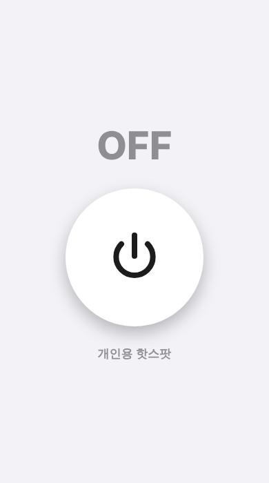
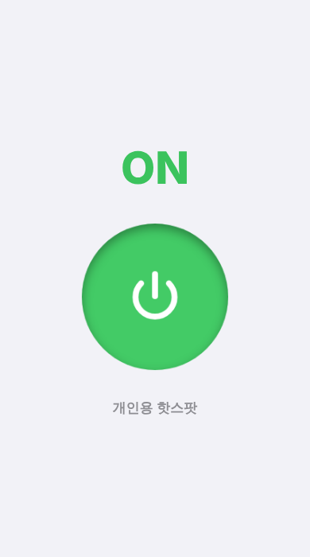
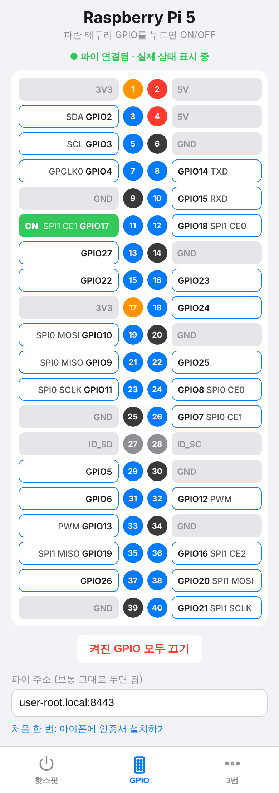

# 아이폰 앱 (iphone-app)

아이폰에서 앱처럼 실행되는 **탭 3개짜리 웹앱**.
- **1번 탭 (핫스팟)**: 버튼 1개로 아이폰 **개인용 핫스팟 켜고 끄기** (파트 1)
- **2번 탭 (GPIO)**: 라즈베리 파이 5 **핀아웃**을 보고, 누른 **GPIO를 ON/OFF** (파트 2 → [아래 설명](#파트-2-gpio-탭-라즈베리-파이-5-핀아웃))
- **3번 탭**: 비워 둠 (다음 기능용)

- 웹앱 주소: https://cheul0518.github.io/RaspberryPi/iphone-app/
- 1번 탭 동작: 버튼을 누르면 눌린 채로 **ON** + 핫스팟 켜짐, 다시 누르면 원위치 **OFF** + 핫스팟 꺼짐
- 확인 환경: iPhone 17 (iOS 26), 홈 화면 웹앱 → 단축어 실행 → 웹앱으로 자동 복귀 동작 확인 (2026-10-13, 1번 탭)

| OFF | ON |
|-----|-----|
|  |  |

<br><br><br>

## 구조
```
[홈 화면 아이콘(웹앱)] --버튼--> [단축어 앱: 핫스팟 켜기/끄기] --자동 복귀(webapp://)--> [같은 웹앱 화면: ON/OFF 표시]
```
- **웹앱**: HTML + CSS + JavaScript 한 파일(`index.html`). GitHub Pages로 무료 호스팅
- **단축어(Shortcuts)**: 아이폰 기본 앱. "개인용 핫스팟 설정" 동작으로 실제 핫스팟을 켜고 끔
- 단축어 실행 후 `webapp://` 주소(iOS 26)로 홈 화면 웹앱에 자동 복귀. 안 되면 왼쪽 위 **◀** 로 복귀 (새 탭은 생기지 않음)
- 파이가 아니라 인터넷(GitHub Pages)에 올린 이유: 핫스팟이 꺼진 상태에서도 페이지가 열려야 하기 때문

<br><br><br>

## 왜 단축어를 거쳐야 할까?
- iOS는 보안상 **웹페이지뿐 아니라 일반 앱(App Store 앱, Xcode로 만든 앱 포함)도 핫스팟을 직접 켜고 끄지 못하게** 막아 둠 (공개 API 없음)
- 대신 단축어 앱의 "개인용 핫스팟 설정" 동작은 허용됨 (iOS 16 이상)
- 그래서 웹앱은 URL 스킴 `shortcuts://`로 단축어를 실행하고, 끝나면 다시 웹앱으로 돌아오게 함
- 결론: Mac + Xcode로 네이티브 앱을 만들어도 단축어는 여전히 필요

<br><br><br>

## 설정 방법 (아이폰, 한 번만)

### 1. 단축어 2개 만들기
1. 단축어 앱 → 오른쪽 위 `+` → **동작 추가** → `핫스팟` 검색 → **"개인용 핫스팟 설정"** → "켜기" 그대로 → 이름 **`핫스팟 켜기`**
2. 만든 단축어를 길게 눌러 **복제** → 동작의 "켜기"를 **"끄기"**로 변경 → 이름 **`핫스팟 끄기`**
- 이름은 띄어쓰기까지 정확히 같아야 함 (코드의 `SHORTCUT_ON`, `SHORTCUT_OFF`와 일치)
- 단축어는 파일로 자동 설치 불가: iOS는 Apple 서명된 단축어 파일만 가져올 수 있고, 서명은 Mac에서만 가능

### 2. 홈 화면에 추가 (앱처럼 독립 창으로)
1. Safari에서 https://cheul0518.github.io/RaspberryPi/iphone-app/ 열기
2. 공유 버튼 → **홈 화면에 추가** → **"웹 앱으로 열기" 켜기** → 이름 `핫스팟` → 추가
3. 이후엔 홈 화면 아이콘으로만 실행 (주소창 없는 독립 창, 실행할 때마다 Safari 탭이 생기지 않음)
4. 처음 누를 때 "단축어에서 열겠습니까?" 확인이 뜨면 열기
- 예전에 추가한 아이콘이 Safari 탭으로 열리면: 그 아이콘 삭제 → Safari 탭 정리 → 위 순서로 다시 추가

### 3. 파이가 핫스팟에 자동 접속하게 (라즈베리 파이에서 한 번만)
목표: **1순위 아이폰 핫스팟, 2순위 지금 쓰는 Wi-Fi**. 핫스팟이 켜지면 30초 안에 자동으로 넘어가고, 꺼지면 원래 Wi-Fi로 돌아감.

아이폰: 설정 → 개인용 핫스팟 → **"호환성 최대화"** 켜기 (연결 안정). 핫스팟 이름은 설정 → 일반 → 정보 → 이름.

**① 핫스팟 저장 + 우선순위 지정** (아이폰 핫스팟을 켜 둔 상태에서)
```bash
sudo nmcli dev wifi connect "iPhone" password "비밀번호"   # "비밀번호" 자리에 아이폰 핫스팟 비밀번호 (설정 → 개인용 핫스팟)
nmcli -f NAME,TYPE,AUTOCONNECT-PRIORITY connection show   # 저장된 Wi-Fi 목록에 iPhone, iptime 이 있는지 확인 (lo 는 무시)

sudo nmcli connection modify "iPhone" connection.autoconnect-priority 10   # 1순위
sudo nmcli connection modify "iptime" connection.autoconnect-priority 5  # 2순위

nmcli -f NAME,TYPE,AUTOCONNECT-PRIORITY connection show   # 순위가 바뀌었는지 다시 확인
```
정상이면 이렇게 나옴 (순서는 다를 수 있음):
```
NAME    TYPE      AUTOCONNECT-PRIORITY
iPhone  wifi      10
iptime  wifi      5
lo      loopback  0
```
- `"iPhone"` = 아이폰 핫스팟 이름, `"iptime"` = 지금 쓰는 Wi-Fi 연결 이름 (`nmcli connection show`로 확인). 다르면 그 부분만 바꾸기
- 우선순위 숫자가 클수록 먼저 접속 (부팅할 때 둘 다 보이면 핫스팟 선택)
- 핫스팟이 꺼지면 NetworkManager가 자동으로 2순위 Wi-Fi에 다시 접속

**② 이미 다른 Wi-Fi에 붙어 있을 때도 핫스팟으로 넘어가게**

NetworkManager는 이미 연결된 상태에서는 더 높은 순위 Wi-Fi가 나타나도 스스로 갈아타지 않음 (①의 순위는 부팅·재접속할 때만 적용). 그래서 30초마다 핫스팟이 보이는지 확인해서 전환하는 스크립트를 등록 ([pi/](./pi/), 파일 3개 한 줄씩 설명: [pi/README.md](./pi/README.md)).

```bash
# 1) 파일 받기
cd ~
git clone https://github.com/cheul0518/RaspberryPi.git   # 처음 한 번만
# 이미 받은 적 있으면 clone 대신 최신 내용만 받기:
#   cd ~/RaspberryPi && git pull
cd ~/RaspberryPi/iphone-app/pi

# 2) 설치
sudo cp hotspot-priority.sh /usr/local/bin/
sudo chmod +x /usr/local/bin/hotspot-priority.sh
sudo cp hotspot-priority.service hotspot-priority.timer /etc/systemd/system/

# 3) 서비스 파일에 핫스팟 이름 넣기 (핫스팟 이름이 iPhone이 아니면 "iPhone"만 바꿔서 실행)
sudo sed -i 's|^ExecStart=.*|ExecStart=/usr/local/bin/hotspot-priority.sh "iPhone"|' /etc/systemd/system/hotspot-priority.service
grep ExecStart /etc/systemd/system/hotspot-priority.service
# ↑ 정상: ExecStart=/usr/local/bin/hotspot-priority.sh "iPhone"   (따옴표 안이 핫스팟 이름과 같으면 OK)

# 4) 켜기
sudo systemctl daemon-reload
sudo systemctl enable --now hotspot-priority.timer

# 5) 확인
systemctl list-timers hotspot-priority.timer
# ↑ 정상: hotspot-priority.timer 줄이 있고, NEXT(다음 실행 시각)가 30초 이내로 표시됨
#   "0 timers listed" 가 나오면 4) 를 다시 실행

nmcli -g GENERAL.CONNECTION device show wlan0
# ↑ 핫스팟을 켜고 30초쯤 뒤: iPhone 이 나오면 성공 (핫스팟을 끄면 잠시 뒤 iptime)

journalctl -u hotspot-priority -n 20
# ↑ 전환된 적이 있으면: "핫스팟 'iPhone' 발견 → 전환" 줄이 보임
#   이미 iPhone 에 붙어 있거나 핫스팟이 꺼져 있으면 아무 메시지 없이 실행만 기록됨 (정상)
```

**명령어 설명 (설치)**
| 명령어 | 하는 일 |
|-----|-----|
| `git clone https://github.com/...` | GitHub 저장소 파일을 파이로 통째로 내려받기 (`~/RaspberryPi` 폴더 생성, 처음 한 번만) |
| `git pull` | 이미 받은 폴더(`~/RaspberryPi`) 안에서 실행하면 GitHub의 바뀐 내용만 받아 최신으로 맞춤 |
| `sudo cp hotspot-priority.sh /usr/local/bin/` | 스크립트를 시스템 프로그램 폴더로 복사 (어디서든 실행 가능) |
| `sudo chmod +x ...` | 스크립트에 실행 권한 주기 |
| `sudo cp *.service *.timer /etc/systemd/system/` | systemd(리눅스 자동 실행 관리자)에 "무엇을"(service), "언제"(timer) 실행할지 등록 |
| `sudo sed -i 's\|^ExecStart=.*\|ExecStart=... "iPhone"\|' ...` | 서비스 파일에서 `ExecStart=`로 시작하는 줄을 실제 핫스팟 이름이 들어간 줄로 통째로 바꾸기. `sed`는 글자 찾아 바꾸기 명령, `s\|찾을것\|바꿀것\|` 형식(구분 기호로 `/` 대신 `\|` 사용), `^`는 줄의 시작, `.*`는 나머지 전부, `-i`는 파일에 바로 저장 |
| `sudo systemctl daemon-reload` | systemd에게 새 파일을 다시 읽으라고 알림 |
| `sudo systemctl enable --now ...timer` | 타이머를 지금 바로 시작(`--now`) + 부팅 때마다 자동 시작(`enable`) |

**명령어 설명 (30초마다 실행되는 것)**

타이머(`hotspot-priority.timer`)가 부팅 20초 후(`OnBootSec=20`)부터 30초마다(`OnUnitActiveSec=30`) 서비스(`hotspot-priority.service`)를 실행 → 서비스가 스크립트(`hotspot-priority.sh "iPhone"`)를 실행. 스크립트 안에서 하는 일:

| 순서 | 명령어 | 하는 일 |
|-----|-----|-----|
| 1 | `nmcli -g GENERAL.CONNECTION device show wlan0` | 지금 Wi-Fi(wlan0)에 연결된 이름 확인 → 이미 핫스팟이면 여기서 끝 |
| 2 | `nmcli -g SSID device wifi list ifname wlan0 --rescan yes` | 주변 Wi-Fi를 새로 검색해서 이름 목록 가져오기 |
| 3 | `grep -Fxq "iPhone"` | 그 목록에 핫스팟 이름이 정확히 있는지 확인 (`-F` 글자 그대로, `-x` 한 줄 전체 일치, `-q` 결과만) |
| 4 | `nmcli connection up id "iPhone" ifname wlan0` | 있으면 저장된 핫스팟 연결로 전환. 없으면 아무것도 안 함 (기존 Wi-Fi 유지) |

- `nmcli`: NetworkManager(Raspberry Pi OS의 네트워크 관리자)를 명령어로 조작하는 도구
- `-g 항목`: 필요한 값만 깔끔하게 출력
- 로그 보기: `journalctl -u hotspot-priority -n 20` (전환될 때 "핫스팟 'iPhone' 발견 → 전환" 출력)

주의할 점
- 스크립트는 **연결 이름 = 핫스팟 이름(SSID)** 이라고 가정. ①처럼 `nmcli dev wifi connect`로 저장하면 자동으로 같아짐. `nmcli connection show`에 보이는 이름을 그대로 쓰기
- 아이폰 핫스팟은 연결된 기기가 없으면 잠시 뒤 신호를 멈추거나 꺼짐 → 파이가 못 찾으면 아이폰에서 **설정 → 개인용 핫스팟 화면을 열어 둔 채** 30초 정도 기다리기
- 30초마다 주변 Wi-Fi를 검색하므로 그 순간 Wi-Fi가 아주 잠깐 느려질 수 있음 (간격은 `.timer`의 `OnUnitActiveSec`로 조절)
- 핫스팟을 끄면 NetworkManager가 자동으로 2순위 Wi-Fi(iptime)에 다시 접속 (스크립트는 핫스팟으로 "넘어가는" 일만 함)
- 끄려면: `sudo systemctl disable --now hotspot-priority.timer`

<br><br><br>

## 파트 2: GPIO 탭 (라즈베리 파이 5 핀아웃)



2번 탭에 라즈베리 파이 5의 40핀 헤더가 실제 배치대로 나옴 (왼쪽 = 홀수 핀, 오른쪽 = 짝수 핀, 맨 위 = 1번 핀).
- 색: 주황 = 3.3V, 빨강 = 5V, 검정 = GND(접지), 파랑 = **누를 수 있는 GPIO**, 회색 = ID 핀(HAT 정보용, 사용 안 함)
- 파란 테두리 GPIO를 누르면 초록색 **ON** + 파이의 그 핀에 3.3V 출력, 다시 누르면 **OFF**
- 1번 핀 위치: 핀 헤더에서 **USB·LAN 포트 반대쪽 끝**
- GPIO 옆 작은 글씨 = 그 핀의 **대표 보조 기능** 1개 (그냥 켜고 끌 때는 무시해도 됨)
  - 핀 하나에 기능이 여러 개라 문서마다 다르게 적혀 있을 수 있음. 예: GPIO18 = `SPI1 CE0` / `PCM CLK`(파이 5에서는 I2S) / `PWM` 모두 맞음. 웹앱은 SPI 기준으로 통일
  - `SDA`·`SCL` = I2C, `TXD`·`RXD` = 시리얼(UART), `SPI0`·`SPI1` = SPI 장치 연결, `PWM` = 밝기·속도 조절용 신호, `GPCLK0` = 클럭 출력
- "켜진 GPIO 모두 끄기": 이 웹앱으로 켠 핀을 전부 OFF
- 단축어 없이 바로 켜고 꺼지며, 2초마다 파이의 실제 상태를 읽어 와 표시 (점선 테두리 = 입력·다른 기능으로 쓰는 중)

### 구조
```
[웹앱 2번 탭] --GPIO17 누름--> https://user-root.local:8443/gpio/17/on --> [파이: gpio-server.py] --> GPIO17 ON
             <-- 2초마다 https://user-root.local:8443/gpio 로 실제 상태 읽기 --
```
- **단축어 없이** 웹앱이 파이에 직접 요청. 누르면 바로 켜지고, 2초마다 파이의 **실제 핀 상태**를 읽어 화면에 표시 (다른 프로그램이 바꾼 것도 보임)
- 웹앱은 `https://`(GitHub Pages)라서 파이도 `https://`여야 직접 요청 가능 (보안 규칙: https 페이지는 http 주소에 요청 못 함). 그래서 파이에 **직접 만든 인증서**를 쓰고, 아이폰이 그 인증서를 믿도록 한 번 설치함
- 아이폰과 파이가 **같은 네트워크**(아이폰 핫스팟 또는 같은 iptime Wi-Fi)에 있어야 동작
- GPIO 탭 위 글자: 초록 "● 파이 연결됨" = 정상, 빨강 "연결 안 됨" = 아래 문제 해결 참고
- 예전에 만든 단축어 `GPIO 제어`는 이제 안 씀 (지워도 됨)

### 4. 파이에 GPIO 서버 설치 (라즈베리 파이에서 한 번만)
추가 설치 없이 동작 (파이썬 기본 웹 서버 + Raspberry Pi OS에 기본 포함된 `gpiozero`, `pinctrl`, `openssl`).
```bash
# 1) 최신 파일 받기
cd ~/RaspberryPi && git pull
cd ~/RaspberryPi/iphone-app/pi

# 2) https 인증서 만들기 (처음 한 번만)
sudo bash make-cert.sh
# ↑ 정상: 마지막 줄에 "완료: /etc/gpio-server 에 인증서를 만들었어요 (주소: user-root.local)"
#   (중간에 ..... +++++ 같은 줄이 나오는 건 정상)

# 3) 서버 설치
sudo cp gpio-server.py /usr/local/bin/
sudo cp gpio-server.service /etc/systemd/system/

# 4) 켜기 (지금 바로 + 부팅 때마다 자동). 이미 설치했었다면 restart 로 새 버전 적용
sudo systemctl daemon-reload
sudo systemctl enable --now gpio-server
sudo systemctl restart gpio-server

# 5) 확인
systemctl is-active gpio-server
# ↑ 정상: active   (failed 가 나오면 아래 journalctl 로 오류 확인)

journalctl -u gpio-server -n 5
# ↑ 정상: "GPIO 서버 시작: 포트 8000" 과 "https 시작: 포트 8443" 두 줄이 보임
#   "https 꺼짐: 인증서가 없어요" 가 보이면 2) 를 다시 실행 후 restart

curl -k -H "X-GPIO: 1" https://localhost:8443/gpio/17/on
# ↑ 정상: {"pin": 17, "on": true}   (GPIO17에 LED를 연결했다면 켜짐)
#   -k = 이 테스트에서는 인증서 확인을 건너뜀 (파이 안에서 시험할 때만)
#   -H "X-GPIO: 1" = 켜고 끄는 요청에 꼭 붙이는 표시 (없으면 {"error": "X-GPIO 머리말 없음"})
curl -k https://localhost:8443/gpio
# ↑ 정상: {"2": {"mode": "ip", "on": false}, ... "17": {"mode": "op", "on": true}, ...}
#   mode: op = 출력, ip = 입력, no = 안 씀, a0~a8 = 다른 기능(I2C·SPI 등)
curl -k -H "X-GPIO: 1" https://localhost:8443/gpio/17/off
# ↑ 정상: {"pin": 17, "on": false}

hostname
# ↑ 파이 이름. 이 파이는 user-root → 웹앱 주소 user-root.local:8443 (웹앱 기본값)
#   다른 이름(예: mypi)이 나오면 웹앱 2번 탭 아래 "파이 주소"에 mypi.local:8443 입력
#   (이름이 다르면 아이폰이 파이를 못 찾음)
```

### 5. 아이폰에 인증서 설치 (아이폰에서 한 번만)
파이가 핫스팟(또는 같은 iptime Wi-Fi)에 붙어 있는 상태에서:
1. **Safari 앱**에서 `http://user-root.local:8000/ca.crt` 열기 (웹앱 GPIO 탭 맨 아래 "처음 한 번: 아이폰에 인증서 설치하기"를 눌러도 됨)
   → "구성 프로파일을 다운로드하려고 합니다" → **허용** → "프로파일이 다운로드됨" → 닫기
2. 설정 → 일반 → **VPN 및 기기 관리** → `user-root GPIO CA` → **설치** → 아이폰 암호 → **설치** → 완료
3. 설정 → 일반 → 정보 → 맨 아래 **인증서 신뢰 설정** → `user-root GPIO CA` **켜기** → 계속
4. 확인: Safari에서 `https://user-root.local:8443/gpio` 열기
   - 정상: 경고 없이 `{"2": {"mode": ...` 같은 글자가 보임
   - "연결이 비공개로 설정되어 있지 않습니다" 경고: 3번(신뢰 켜기)이 빠졌거나, 파이에서 인증서를 새로 만듦 → 1~3번 다시
   - "서버를 찾을 수 없음": 주소의 이름이 파이 이름(`hostname`)과 다름
   - "서버에 연결할 수 없음": 파이가 핫스팟에 안 붙었거나 서버가 꺼짐 → 4번의 5) 확인
5. 웹앱을 완전히 닫았다가 다시 열기 → GPIO 탭 위에 초록 **"● 파이 연결됨 · 실제 상태 표시 중"** 이 나오면 끝

이 인증서는 승철 님 파이의 `user-root.local` 주소에만 쓰이는 것. 지우려면 설정 → 일반 → VPN 및 기기 관리 → `user-root GPIO CA` → 프로파일 제거.

### LED로 테스트하기
GPIO17(11번 핀) → 저항(220~330Ω) → LED 긴 다리, LED 짧은 다리 → GND(9번 또는 14번 핀). 웹앱 2번 탭에서 **GPIO17**을 누르면 LED가 켜짐.

### 알아 둘 점
- 화면의 ON은 파이에서 2초마다 읽어 온 **실제 상태**. 점선 테두리 = 그 핀을 입력이나 다른 기능(I2C·SPI 등)으로 쓰는 중
- "켜진 GPIO 모두 끄기"는 **이 서버로 켠 핀**만 끔 (다른 프로그램이 켠 핀은 그 프로그램에서 끄기)
- GPIO는 **3.3V, 약한 전류**만 출력. 모터·릴레이 등은 직접 연결하지 말고 트랜지스터/드라이버 모듈을 거칠 것
- **보안**
  - 밖(인터넷)에서는 파이에 접속할 수 없음 (공유기 포트포워딩을 안 했으므로)
  - 핫스팟을 쓰면 핫스팟 비밀번호를 아는 기기만 같은 네트워크에 들어옴. 같은 iptime Wi-Fi에서는 그 Wi-Fi에 접속한 사람이 직접 명령어로 GPIO를 켤 수는 있음 (비밀번호 없음)
  - 다른 웹사이트가 내 아이폰 브라우저를 이용해 몰래 켜고 끄는 것은 막혀 있음: 서버가 `https://cheul0518.github.io` 웹앱의 요청만 받음
  - 아이폰에 설치한 인증서는 `user-root.local` 주소에만 쓸 수 있게 제한돼 있어서, 파이의 키가 새더라도 은행·포털 같은 다른 사이트를 흉내 내는 데 쓸 수 없음
- 서버 끄기: `sudo systemctl disable --now gpio-server`
- 파일 한 줄씩 설명: [pi/README.md](./pi/README.md)

<br><br><br>

## 코드 핵심 (`index.html`)
```js
const SHORTCUT_ON = '핫스팟 켜기';
const SHORTCUT_OFF = '핫스팟 끄기';
// 2번 탭(GPIO)은 단축어 없이 fetch('https://user-root.local:8443/gpio/17/on') 로 파이에 직접 요청

// 버튼을 누르면: 화면을 먼저 ON/OFF로 바꾸고 단축어 실행
const back = encodeURIComponent('webapp://' + location.host + location.pathname);  // 홈 화면 웹앱 주소
const url = 'shortcuts://x-callback-url/run-shortcut?name=' + encodeURIComponent(이름)
  + '&x-success=' + back + '&x-cancel=' + back + '&x-error=' + back;
location.href = url;
```
- 탭 번호·핫스팟 버튼 상태는 단축어를 부르기 **전에** `localStorage`(브라우저 저장소)에 저장 → 웹앱으로 돌아왔을 때 같은 ON/OFF 화면 유지
- 자동 복귀는 `x-callback-url`의 `x-success`에 `webapp://도메인/경로` 사용 (iOS 26부터 홈 화면 웹앱을 여는 주소). `https://`로 돌아오게 하면 Safari **새 탭**이 생김
- `webapp://`은 경로·파라미터를 무시하고 앱만 열어서, 상태는 단축어 실행 **전에** 저장. 일부 iOS 버전에서는 "주소가 유효하지 않음" 오류가 난다는 보고도 있음 → 그때는 **◀** 로 복귀
- 공백은 반드시 `%20`으로 인코딩 (`URLSearchParams`는 공백을 `+`로 바꿔 단축어 이름이 안 맞음)
- 눌린 버튼 효과: CSS에서 `transform: scale(.92)` + 안쪽 그림자(`inset box-shadow`)

<br><br><br>

## 문제 해결
| 증상 | 원인 / 해결 |
|-----|-----|
| "'핫스팟 끄기' 단축어를 찾을 수 없습니다" | 단축어가 없거나 이름이 다름 → 위 1번대로 이름 정확히 만들기 |
| 버튼 표시와 실제 핫스팟 상태가 다름 | 웹앱은 실제 상태를 읽을 수 없음 (제어센터에서 따로 바꾼 경우) → 한 번 더 누르면 맞춰짐 |
| 실행할 때마다 Safari 새 탭이 생김 | 홈 화면 아이콘이 Safari 탭으로 열리는 상태. 아이콘 삭제 → 탭 정리 → **"웹 앱으로 열기" 켜고** 다시 추가 (2번 참고) |
| 단축어 실행 후 단축어 앱에 머묾 / "주소가 유효하지 않음" | 이 iOS에서 `webapp://` 복귀가 안 되는 경우. 핫스팟은 이미 바뀌었으니 왼쪽 위 **◀** 로 돌아가기 |
| 단축어 실행에 실패했는데 버튼은 바뀜 | 버튼을 한 번 더 눌러 맞추기 (단축어 이름 확인) |
| 파이가 핫스팟에 안 붙음 | "호환성 최대화" 켜기, 핫스팟 설정 화면을 열어 둔 채 기다리기, `journalctl -u hotspot-priority`로 로그 확인 |
| GPIO 탭에 빨강 "파이에 연결 안 됨" | Safari에서 `https://user-root.local:8443/gpio`가 경고 없이 열리는지 확인 (5번의 4) → 경고가 나오면 인증서 신뢰 켜기, 안 열리면 핫스팟 연결·`systemctl is-active gpio-server` 확인 |
| 화면은 ON인데 LED가 안 켜짐 | 배선·LED 방향(긴 다리가 GPIO 쪽)·저항 확인 |
| "GPIO17 실패: ... 쓸 수 없어요" | 다른 프로그램이 그 핀을 쓰는 중 → 그 프로그램을 끄거나 다른 GPIO 사용 |
| 파이가 핫스팟으로 안 넘어감 | 서비스 파일의 핫스팟 이름이 `nmcli connection show`의 이름과 정확히 같은지 확인 |

<br><br><br>

## 공개 범위
- GitHub Pages는 저장소별 설정 → 이 저장소만 웹 주소가 생기고, 다른 저장소는 영향 없음
- 주소를 아는 사람은 페이지를 열 수 있지만, 버튼은 **누른 사람 폰의 단축어**만 실행 → 남이 내 핫스팟을 조작할 수 없음
- 개인정보·비밀번호 없음

<br><br><br>

## 다음 파트 예정
- 3번 탭: 비워 둠 (다음에 추가할 기능)
